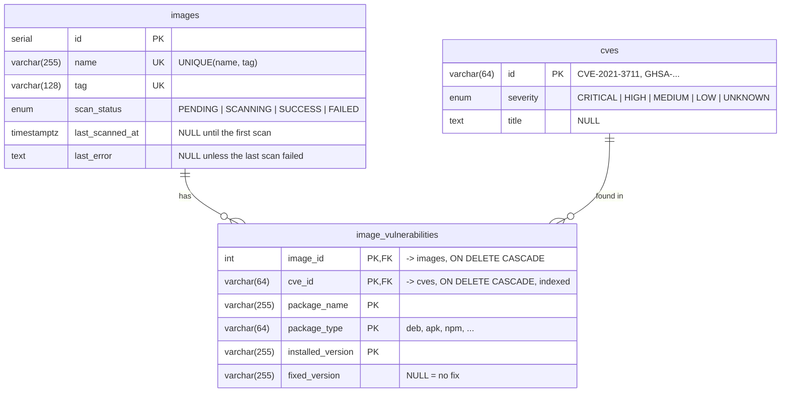

# Database

Three Postgres tables, created by one migration
([src/database/migrations](../src/database/migrations)) on startup.

- `images`: one row per `name:tag`, with the scan status.
- `cves`: one row per CVE.
- `image_vulnerabilities`: one row per finding (image + package version + CVE).

## Indexes

| Query                      | Uses                                | Time    |
| -------------------------- | ----------------------------------- | ------- |
| CVEs of an image           | primary key, starts with `image_id` | ~2 ms   |
| Images with a CVE          | `idx_image_vuln_cve (cve_id)`       | ~0.3 ms |
| Image by name and tag      | `uq_images_name_tag (name, tag)`    |         |
| Full image list / CVE list | one pass over the findings          | ~7 ms   |

Times are from `EXPLAIN ANALYZE` on real data (10 images, 980 CVEs, ~3,400 findings).

## Notes

- Findings are a snapshot: a scan replaces the image's findings in one transaction, so fixed
  CVEs disappear and the table doesn't grow. A failed scan keeps the old results.
- Package info sits on the finding, not in its own table, since it's only used together with an
  image and a CVE. `package_type` keeps same-named packages (Debian vs npm) apart.
- The findings key is its identifying columns, so duplicates can't happen.
- `severity` is an enum ordered from `CRITICAL`, so `ORDER BY severity` sorts by importance.
- The CVE upsert skips unchanged rows (2,168 updates per round down to 35).
- Saving locks the image row first, so two saves of the same image wait for each other.
